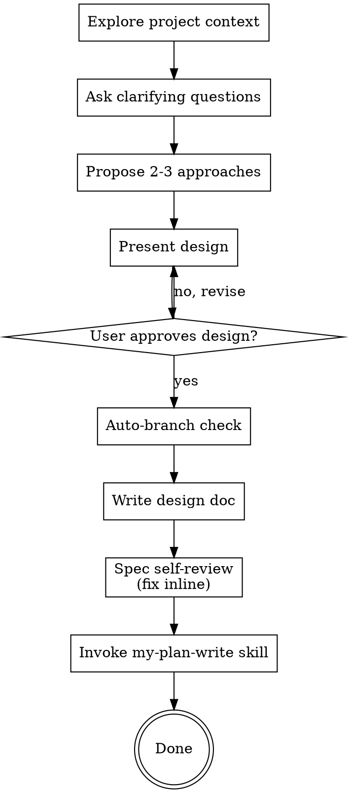

# Brainstorming Ideas Into Designs

Help turn ideas into fully formed designs and specs through natural collaborative dialogue.

Start by understanding the current project context, then ask questions one at a time to refine the idea. Once you understand what you're building, present the design and get user approval.

<HARD-GATE>
When this skill is active, do NOT invoke any implementation skill, write any code, scaffold any project, or take any implementation action until you have presented a design and the user has approved it.
</HARD-GATE>

## Scope & Alignment with `my-sess-open` / `AGENTS.md`

- **Intra-Phase Scope Boundary**: In a multi-phase session (active `.agents/plans/*/macro.md`), `my-plan-design` operates strictly as an intra-phase design skill for the **current active Phase**. Never expand specs into subsequent deferred phases.
- **When to use full Spec + Plan workflow**: New features, multi-module changes, or ambiguous requirements where architectural trade-offs and a persistent design spec (`.agents/plans/YYYY-MM-DD-<topic>/phase-XX.md`, `phase-XX-design.md` when paired with `my-plan-write`, or `design.md` for standalone single-phase tasks) add clarity within the active Phase (or standalone task).
- **When standard `AGENTS.md` flow suffices**: Routine bug fixes, config updates, or localized changes already clarified via `my-sess-open` Step 4 (User Interview) can follow `AGENTS.md`'s Two-Tier Execution Flow (Single-Phase Fast Path or simple Phase JIT Detailed Plan) without generating separate spec and plan markdown files.

## Checklist

You MUST create a task for each of these items and complete them in order:

1. **Explore project context** — check files, docs, recent commits
2. **Ask clarifying questions** — one at a time, understand purpose/constraints/success criteria
3. **Propose 2-3 approaches** — with trade-offs and your recommendation
4. **Present design & obtain user approval** — scaled to complexity, single cohesive approval (or section-by-section only for multi-component designs)
5. **Auto-branch check** — ensure an active task branch per `my-sess-open` SSoT (if invoked standalone on `main`/`master` or an unrelated branch, automatically create `git checkout -b <prefix>/<slug> <base-branch>` without asking)
6. **Write design doc** — save to `.agents/plans/YYYY-MM-DD-<topic>/phase-XX-design.md` (or `phase-XX.md` when standalone in Phase XX; `design.md` for single-phase tasks, per `AGENTS.md` Guideline 6)
7. **Spec self-review** — quick inline check for placeholders, contradictions, ambiguity, scope (see below)
8. **Transition to implementation** — invoke `my-plan-write` skill immediately without a second spec-review wait

## Process Flow

**The terminal state is invoking my-plan-write.** Do NOT invoke frontend-design, mcp-builder, or any other implementation skill. The ONLY skill you invoke after my-plan-design is `my-plan-write`.

## The Process

**Understanding the idea:**

- Check out the current project state first (files, docs, recent commits)
- Before asking detailed questions, check if an active `.agents/plans/*/macro.md` exists; if so, scope `my-plan-design` strictly to the **current active Phase** rather than re-decomposing future phases. Otherwise, if a standalone request describes multiple independent subsystems (e.g., "build a platform with chat, file storage, billing, and analytics"), flag this immediately. Don't spend questions refining details of a project that needs to be decomposed first.
- If a standalone project is too large for a single spec, help the user decompose into sub-projects (or Tier 1 Macro Phases): what are the independent pieces, how do they relate, what order should they be built? Then brainstorm only the first sub-project/Phase through the normal design flow. Each sub-project gets its own spec → plan → implementation cycle.
- For appropriately-scoped projects, ask questions one at a time to refine the idea
- Prefer multiple choice questions when possible, but open-ended is fine too
- Only one question per message - if a topic needs more exploration, break it into multiple questions
- Focus on understanding: purpose, constraints, success criteria

**Exploring approaches:**

- Propose 2-3 different approaches with trade-offs
- Present options conversationally with your recommendation and reasoning
- Lead with your recommended option and explain why

**Presenting the design:**

- Once you believe you understand what you're building, present the design as a single cohesive proposal scaled to its complexity for one approval (break into section-by-section checkpoints only when multi-component complexity genuinely warrants it)
- Cover: architecture, components, data flow, error handling, testing
- Be ready to go back and clarify if something doesn't make sense

**Design for isolation and clarity:**

- Break the system into smaller units that each have one clear purpose, communicate through well-defined interfaces, and can be understood and tested independently
- For each unit, you should be able to answer: what does it do, how do you use it, and what does it depend on?
- Can someone understand what a unit does without reading its internals? Can you change the internals without breaking consumers? If not, the boundaries need work.
- Smaller, well-bounded units are also easier for you to work with - you reason better about code you can hold in context at once, and your edits are more reliable when files are focused. When a file grows large, that's often a signal that it's doing too much.

**Working in existing codebases:**

- Explore the current structure before proposing changes. Follow existing patterns.
- Where existing code has problems that affect the work (e.g., a file that's grown too large, unclear boundaries, tangled responsibilities), include targeted improvements as part of the design - the way a good developer improves code they're working in.
- Don't propose unrelated refactoring. Stay focused on what serves the current goal.

## After the Design

**Documentation:**

- Write the validated design (spec) to `.agents/plans/YYYY-MM-DD-<topic>/phase-XX-design.md` (or `phase-XX.md` when no separate plan file follows; `design.md` for standalone single-phase tasks)
  - (User preferences for spec location override this default)
- Use elements-of-style:writing-clearly-and-concisely skill if available

**Spec Self-Review:**
After writing the spec document, look at it with fresh eyes:

1. **Placeholder scan:** Any "TBD", "TODO", incomplete sections, or vague requirements? Fix them.
2. **Internal consistency:** Do any sections contradict each other? Does the architecture match the feature descriptions?
3. **Scope check:** Is this focused enough for a single implementation plan, or does it need decomposition?
4. **Ambiguity check:** Could any requirement be interpreted two different ways? If so, pick one and make it explicit.

Fix any issues inline. No need to re-review — just fix and move on.

**Implementation Handoff:**

- Immediately invoke the `my-plan-write` skill to create the active Phase (or standalone) detailed implementation plan, without pausing for a second spec-file review or model-selection gate.
- Do NOT invoke any other implementation skill directly before `my-plan-write`.

## Key Principles

- **One question at a time** - Don't overwhelm with multiple questions
- **Multiple choice preferred** - Easier to answer than open-ended when possible
- **YAGNI ruthlessly** - Remove unnecessary features from all designs
- **Explore alternatives** - Always propose 2-3 approaches before settling
- **Incremental validation** - Present design, get approval before moving on
- **Be flexible** - Go back and clarify when something doesn't make sense

## Visual Companion

A browser-based companion for showing mockups, diagrams, and visual options during `my-plan-design`. Available as a tool — not a mode. Activate ONLY when the user explicitly requests browser-based visuals; do NOT send a separate proactive offer message.

**Per-question decision:** Even after the user accepts, decide FOR EACH QUESTION whether to use the browser or the terminal. The test: **would the user understand this better by seeing it than reading it?**

- **Use the browser** for content that IS visual — mockups, wireframes, layout comparisons, architecture diagrams, side-by-side visual designs
- **Use the terminal** for content that is text — requirements questions, conceptual choices, tradeoff lists, A/B/C/D text options, scope decisions

A question about a UI topic is not automatically a visual question. "What does personality mean in this context?" is a conceptual question — use the terminal. "Which wizard layout works better?" is a visual question — use the browser.

If they agree to the companion, read the detailed guide before proceeding:
`skills/my-plan-design/visual-companion.md`
